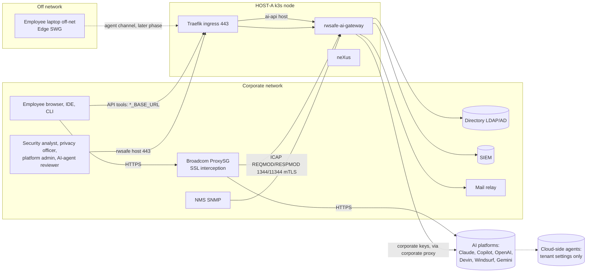
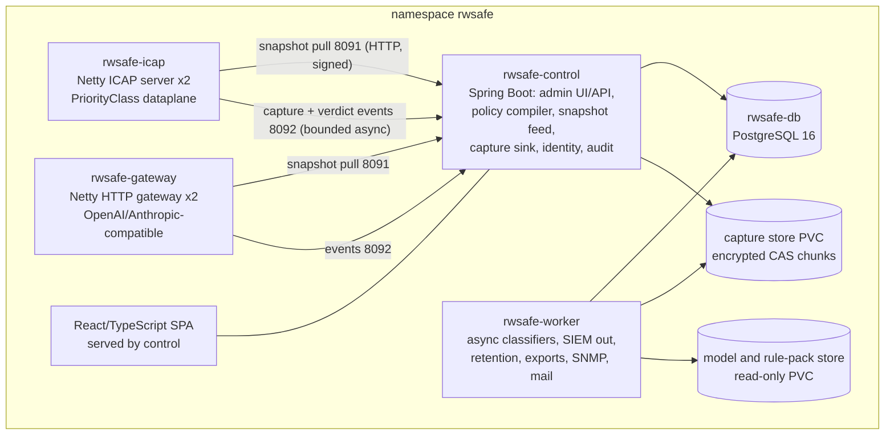

# rwsafe-ai-gateway architecture

**Status:** FROZEN by `docs/design/PO_DECISION_RECORD_2026_10_30_DESIGN_FREEZE.md` (2026-10-30); amended only through a PO decision record or an ADR
that quotes one.

**History:** DRAFT for design freeze (becomes FROZEN by PO decision record). Answers brief section 9 item 1: C4 context,
container and component views; data flows for ICAP, the LLM gateway, the agent channel and admin; sequence diagrams for
login enforcement, prompt capture with redaction, and a blocked request. Decisions are in `docs/adr/`; this document shows
how they fit. Diagrams are text (Mermaid) so they diff and never carry an identifier.

## 1. Context (C4 level 1)



Trust boundaries: the ICAP listener trusts ProxySG only (mTLS + source allowlist); the admin host trusts the directory
for authentication; the gateway host trusts short-lived client credentials; the agent host trusts MDM device
certificates. neXus and rwsafe share the node, Traefik, the registry, the directory and the SIEM, and nothing else.

## 2. Containers (C4 level 2)



| Container | Image | Replicas, strategy | Talks to | Never talks to |
|---|---|---|---|---|
| `rwsafe-icap` | `rwsafe-dataplane` (Netty jar, no Spring MVC, no JDBC on the classpath) | 2, RollingUpdate 0/1, PDB | ProxySG (in), control 8091/8092 | database, capture store, Internet |
| `rwsafe-gateway` | `rwsafe-dataplane` (same jar, gateway role) | 2, RollingUpdate 0/1, PDB | Traefik (in), AI upstreams via the corporate proxy (out), control 8091/8092 | database |
| `rwsafe-control` | `rwsafe-control` (Spring Boot) | 1, Recreate | Traefik (in), DB, capture store, directory, kubelet summary API (read) | AI upstreams |
| `rwsafe-worker` | `rwsafe-control` (worker role by argument) | 1, Recreate | DB, capture store, model store, SIEM, mail relay, NMS (SNMP agent) | Traefik, ProxySG |
| `rwsafe-db` | sclorg PostgreSQL 16 | 1 StatefulSet | control, worker | everything else |

The data plane holds **no credential except its own TLS material and the snapshot verification key**; corporate AI keys
live only in the gateway's Secret and are never in a snapshot (the snapshot carries their HMAC digests for the REQMOD key
class).

## 3. Components (C4 level 3)

### 3.1 Data plane (`rwsafe-dataplane`)

```
netty transport ─► IcapServerHandler ─► IcapCodec (RFC 3507 decoder/encoder, limits)
                                        │
                                        ▼
                               FlowClassifier (platform matrix fingerprints: platform × surface × step)
                                        │
                                        ▼
                               IdentityResolver (proxy claim, surrogate class, group ids from snapshot)
                                        │
                                        ▼
                               PolicyEvaluator (compiled snapshot: tenant rules, class routing, actions, mode)
                                        │
                     ┌──────────────────┼──────────────────┐
                     ▼                  ▼                  ▼
            TenantInspector    ContentInspector     StreamWindowInspector
            (login steps,      (normaliser + Tier-1  (RESPMOD chunks,
             header checks,     detectors, redactor)  high-confidence only)
             key-class)                 │
                                        ▼
                               VerdictBuilder ─► IcapResponder (204 / 200 redact / 200 block page / error)
                                        │
                                        ▼
                               EventEmitter ─► BoundedQueue(capture) + BoundedQueue(verdict, never dropped)
                                                        │ async batch, backpressure
                                                        ▼
                                              CaptureSinkClient (HTTP to control 8092, retry, disk-free aware)
GatewayServerHandler reuses FlowClassifier/PolicyEvaluator/ContentInspector; adds ClientCredentialAuth
(short-lived tokens bound to user+device), UpstreamRouter (fixed allowlist, corporate key injection, no SSRF),
QuotaMeter (per team), StreamRelay (SSE pass-through with window).
SnapshotLoader: pulls signed snapshot, verifies, atomically swaps; persists last good snapshot on emptyDir.
Health: OPTIONS/readiness reflect snapshot presence, drain state, queue pressure.
```

ArchUnit fences for this module: no `java.sql`, no `javax.persistence`, no `java.util.regex.Pattern` on classes under
`inspect.*`, no Spring MVC, no blocking I/O APIs on handler threads, no `Object.toString()` of body-bearing types in logs
(a custom rule over Logback usage).

### 3.2 Control plane (`rwsafe-control`)

Spring Boot: `identity` (LDAP bind or SAML SP, group → role binding, break-glass local accounts, machine sessions for e2e
as in neXus), `rbac` (gate chain: session, CSRF, role, masked-role projection funnel), `policy` (registry tables, YAML
import, compiler, signer, simulation mode, staged rollout, exceptions with expiry, approvals), `platform` (platform matrix
rows as data with evidence links), `capture` (sink endpoint, redaction verification, CAS writer, manifests, retention
classes, legal hold), `privacy` (HMAC pseudonymiser, subnet masker, estate dictionary source, masking funnel, rule-set
version, DSAR search, raw-access grants), `audit` (trigger-backed ledger, SIEM watermarks), `health` (system health,
change feed, coverage metric), `api` (REST for the SPA and the CLI; every UI action has a CLI counterpart), `cli`
(`rwsafe-cli`, same HTTP routes).

### 3.3 Worker (`rwsafe-worker`)

Async ML classifiers (ONNX), SIEM exporter (CEF/LEEF/Splunk HEC, CR/LF and ANSI stripped, no bodies), notifications
(SMTP relay, routes by type), SNMP agent (health OIDs), retention and crypto-shredding, exports (masked by role),
coverage-metric collector (ProxySG access-log summary import, read-only), production canary prompts (synthetic, excluded
from statistics), model and rule-pack verification (signatures, safetensors/ONNX only).

### 3.4 Frontend

React + TypeScript + MUI, neXus design language (status pill, object header, KPI card, data table, state panel, label
map, timestamp); screens: Overview (coverage ratio, verdict mix, tenant enforcement share), Traffic (masked search over
derived features), Incidents (cases, DLP findings as class + digest), Policies (registry, simulation diff, rollout
groups, approvals), Platforms (matrix rows with evidence), Identities and roles, Administration (notifications, SIEM,
retention, masking rules, raw-access grants, break-glass), Health (queues, 204 ratio, disk watermark, drift). Stored
content is rendered inert (SEC-5). Errors show the server's reason.

## 4. Data flows

### 4.1 ICAP (inline)

```mermaid
sequenceDiagram
  participant C as Client
  participant P as ProxySG
  participant I as rwsafe-icap
  participant K as rwsafe-control
  participant V as AI vendor
  C->>P: HTTPS request (intercepted)
  P->>I: ICAP REQMOD (Preview 4 KiB, X-Authenticated-User, Allow 204)
  I->>I: classify flow, resolve identity, evaluate snapshot
  alt allow
    I-->>P: 204 No Content
    P->>V: original request
  else redact
    I-->>P: 200 + rewritten request
    P->>V: redacted request
  else block
    I-->>P: 200 + HTTP 403 block page
    P-->>C: block page
  end
  I-)K: capture + verdict events (async, bounded)
  V-->>P: response (SSE)
  P->>I: ICAP RESPMOD (chunks)
  I-->>P: chunks forwarded; abort on high-confidence leak
  P-->>C: response
```

### 4.2 LLM API gateway

Client (`ANTHROPIC_BASE_URL`/`OPENAI_BASE_URL` = gateway host) → Traefik 443 → `rwsafe-gateway`: client credential
(short-lived, user+device bound, issued by the control plane after directory login) → quota check (in-memory counters
synced to control) → request inspection (same Tier-1) → upstream from a **fixed allowlist** (vendor API hosts and
allowed models/regions per data class) through the corporate proxy with the **corporate key** injected → streaming relay
with window → events to control (cost per team from token counts). A request naming a model or region not allowed for
its data class is refused with the reason.

### 4.3 Agent channel (later phase, ADR-006)

Extension or endpoint agent → `agent.<corp-domain>` 443 with the MDM client certificate → `rwsafe-control` agent API:
snapshot download (same signed snapshot, group-filtered), verdict and metadata reports (never bodies by default),
device kill switch, signed update manifest.

### 4.4 Admin

Operator browser → `rwsafe.<corp-domain>` 443 → control: login (LDAP bind or SAML) → session cookie (`__Host-`) + CSRF →
gate chain (role, masked projection for `replay_viewer`) → screens and REST → CLI parity (`rwsafe-cli`). Every mutation
sets the audit context (`app.actor_fingerprint`, `app.action_id`, `app.reason_code`, `app.correlation_id`) and the trigger
writes the audit row. Business-hours confirmation applies to admin actions that change enforcement (enable/disable a
policy in `enforce` mode, change fail behaviour): the confirmation header pattern from neXus.

### 4.5 Capture pipeline (control plane)

events → sink (validates the redaction proof: a redacted body may not contain any detector hit; the sink re-runs
detectors on C3 text before storing) → C1/C2/C6 rows → C3 chunks (dedup, encrypt) → C4 chunks only if policy, notice
acceptance (C12) and watermark permit → manifests → async worker: ML tier on C3, SIEM export (C1/C2/C6/C7), retention.

## 5. Sequence: login enforcement (tenant restriction)

```mermaid
sequenceDiagram
  participant U as User browser
  participant P as ProxySG
  participant I as rwsafe-icap
  participant V as Vendor sign-in
  U->>P: GET vendor sign-in page
  P->>P: inject tenant header if the vendor has one (Entra, Google, ChatGPT)
  P->>I: REQMOD (step=login, identity=proxy claim)
  I->>I: header present? corporate domain/tenant? mode monitor|enforce
  alt header vendor, header present
    I-->>P: 204 (record tenant_enforced_by=proxy_header)
    P->>V: request with header; vendor refuses non-corporate tenants
  else header vendor, header missing
    I-->>P: enforce: 200 + block page "coverage fault"; monitor: 204 + alert
  else no-header vendor (claude.ai, GitHub, Devin, Windsurf)
    I->>I: inspect identity in the login POST / OAuth callback (fixture-classified step)
    alt corporate identity
      I-->>P: 204
    else personal identity
      I-->>P: 200 + Turkish coaching page: "use the corporate account", justification link
    end
  end
  I-)I: event: login attempt, platform, tenant verdict, no content stored (blocked personal logins store the event only)
```

## 6. Sequence: prompt capture with redaction

```mermaid
sequenceDiagram
  participant U as IDE / browser
  participant P as ProxySG
  participant I as rwsafe-icap
  participant K as rwsafe-control
  participant W as rwsafe-worker
  U->>P: POST /v1/messages {messages:[...], stream:true}
  P->>I: REQMOD full body (Preview then 100 Continue)
  I->>I: normalise; Tier-1 detectors find a secret and a TCKN
  I->>I: policy: class=secret → redact; class=TCKN → redact; notice accepted? watermark ok?
  I-->>P: 200 + body with [REDACTED:SECRET], [REDACTED:TCKN]
  P->>P: forward redacted request to the vendor
  I-)K: event: C1 metadata, C2 verdict REDACT, C6 findings (class, offset, digest), C3 redacted text, C4 none (watermark tripped)
  K->>K: sink re-runs detectors on C3: zero hits required, else reject and alert
  K->>K: dedup chunks, encrypt, manifest, rows (trigger audit)
  W->>W: ML tier on C3 (async); SIEM event (no body); user coaching event
```

## 7. Sequence: a blocked request

```mermaid
sequenceDiagram
  participant U as Browser (chat UI)
  participant P as ProxySG
  participant I as rwsafe-icap
  participant K as rwsafe-control
  participant S as SIEM
  U->>P: POST chat message containing a customer IBAN and account notes
  P->>I: REQMOD
  I->>I: class=banking_secret (fail-closed class) → action BLOCK, mode enforce for this group
  I-->>P: ICAP 200, encapsulated HTTP 403, HTML coaching page (Turkish), X-RWSAFE-Ref
  P-->>U: 403 page: why it was blocked, the class (never the value), how to request an exception
  I-)K: verdict event BLOCK (never dropped), capture event (metadata; content not stored for blocks of this class unless policy says)
  K->>S: CEF event: user pseudonym, platform, class, policy version, ref
  U->>K: optional: justification form on the coaching page → exception request (time-boxed, approval)
```

## 8. Cross-cutting

- **Masking funnel** for `replay_viewer`: one `ResponseBodyAdvice`-style funnel, HMAC pseudonyms (rwsafe key), subnet-
  preserving IP masking, estate dictionary, free-text heuristics incl. Turkish identifiers, rule-set version header,
  503 when the dictionary or key is missing (`MASKING_AND_PRIVACY.md`).
- **Configuration**: everything in `deploy/rwsafe/` (base + overlays); real names in uncommitted ConfigMaps; the deploy
  diffs and reports drift.
- **Observability**: OpenTelemetry traces and Prometheus metrics without raw labels; Instana ingests OTLP (UNVERIFIED
  version); health screen words with colours; JVM GC, direct memory, queue depth, 204 ratio, coverage ratio.
- **Protected windows** and business-hours confirmation as in neXus.
- **Portability**: identical base manifests for k3s and OpenShift; Ingress/Route and quota in overlays.

## 9. Module layout (implementation phase)

```
java/
  platform-core/      vocabulary, action classes, roles, business hours, windows
  detect/             Tier-1 detector library (RE2/J, Aho-Corasick, validators, normaliser), WASM build target
  policy/             registry model, YAML schema, compiler, snapshot signing
  dataplane/          Netty ICAP server, gateway, inspectors, event queues (no Spring MVC, no JDBC)
  persistence/        jOOQ, Flyway migrations, triggers
  control/            Spring Boot admin API, identity, masking funnel, capture sink, policy UI backend
  worker/             async classifiers, SIEM, retention, exports, SNMP, mail
  cli/                rwsafe-cli
  architecture-tests/ ArchUnit fences
  integration-tests/  PostgreSQL Job tests
frontend/             React + TypeScript + MUI + Vitest + Playwright (masked-role e2e, canary probe)
policy/               policy fixtures (YAML), platform matrix data, i18n texts
deploy/rwsafe/        kustomize base + overlays
tools/                hosta inventory, privacy gate, delivery (parameterised), review scripts
```
